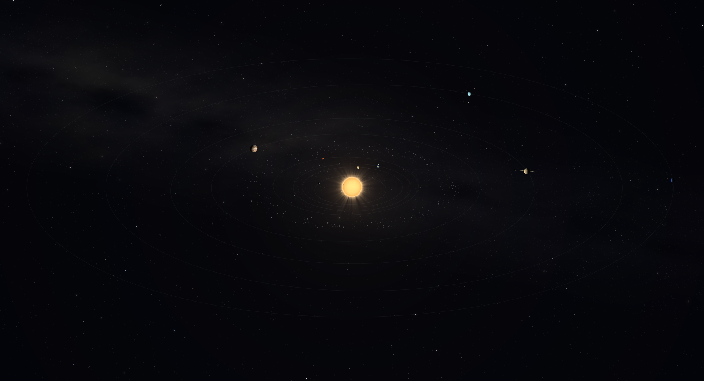

# Solar system

A live solar system as your Omarchy desktop background. The Sun, all eight
planets and 19 moons sit at their **real positions for the current date and
time**, and move as the real ones do.



## Features

- **Real positions.** Planets follow JPL's Keplerian orbital elements (valid
  1800–2050). The Moon uses lunar theory, with its real phase. The moons of
  Mars, Jupiter, Saturn, Uranus and Neptune are fitted to NASA JPL Horizons
  data and stay within about 2–3° in 2025–2027.
- **Real orbits.** Each orbit is drawn as its true Kepler ellipse, with the Sun
  at one focus.
- **Real rotation.** Every globe, the Sun included, turns about its real axis
  (IAU pole and prime meridian). Uranus lies on its side, and Saturn's rings
  tilt with it.
- **Close-ups.** Focus on any planet, the Moon or the Sun and the view flies
  there. Up close each body becomes a photographic globe turning at its real
  rate. Earth gets clouds, and city lights on its night side, and shows the real
  daylit side for the current time.
- **Zoom.** When focused on a body, zoom from a close-up out to the whole
  system, with the body kept in the middle. Every step makes a different
  wallpaper: a planet filling the screen, a planet with its moons, or a planet
  among its neighbours.
- **Two scales.**
  - *Enlarged planets* compresses distances and enlarges the bodies, so
    everything fits on one screen.
  - *Real size* shows true distances and true sizes. The Sun is then a
    quarter-pixel point, so use Focus to see the planets.
  - Switching between them is a smooth four-second flight.
- **Time control.** Live, or 1 min, 1 hour, 1 day, 1 week or 1 month per
  second, with a "Back to now" button.
- **Toggles.** Show or hide the orbits, the asteroid belt and the moons.
- **Any screen.** It is drawn on every monitor. The background fills the
  screen, and the whole system, out to Neptune, fits on any aspect ratio.
  Tested at 3440×1440, 2560×1600, 1920×1080, 1366×768, 1280×800 and 1024×768.
- **Stays out of the way.** It sits below every window and ignores all mouse
  input. It pauses an `owe` video wallpaper while it is shown, and resumes it
  when hidden.

## Install

```bash
omarchy plugin add https://github.com/sup3rbuck/omarchy-solar-system.git --enable
```

The solar system icon (a sun with a planet on its orbit) appears on the right
side of the bar. To place it somewhere else:

```bash
omarchy bar move mog.solar-system --section right
```

## Usage

- **Left click** the bar icon to open the panel.
- **Right click** it to show or hide the solar system.
- **Scroll** over it to zoom in or out on the focused body.

The panel has:

- an on/off switch
- speed: Live, 1 min/s, 1 h/s, 1 day/s, 1 wk/s, 1 mo/s, and Back to now
- scale: Enlarged planets or Real size
- focus: Whole system, Sun, any planet, or the Moon
- zoom (when focused on a body): a slider from Close-up to Whole system
- toggles for orbits, the asteroid belt and moons

Settings are saved in `~/.config/omarchy/mog-solar-system.json`. The simulated
clock always starts at the real present after a reboot or shell restart.

## Remove

```bash
omarchy plugin disable mog.solar-system
omarchy plugin remove mog.solar-system
rm -f ~/.config/omarchy/mog-solar-system.json   # optional: delete saved settings
```

Your regular wallpaper comes back as soon as the plugin is disabled. If it had
paused an `owe` video wallpaper, the video resumes on its own within a few
seconds.

The plugin writes nothing outside its own settings file and a lock file in
`$XDG_RUNTIME_DIR`. It does not change your Omarchy, Hyprland or wallpaper
configuration.

## Requirements and dependencies

- **Omarchy** with the Quickshell-based Omarchy shell. Tested on Omarchy
  4.5.0 with Quickshell 0.3.2.
- **Hyprland:** `hyprctl` is used by the video-wallpaper guard.
- **util-linux:** `flock` is used by the video-wallpaper guard.
- **Optional:** [`owe`](https://github.com/omacom/owe) video wallpaper. Without it the
  guard does nothing.
- A GPU with working OpenGL or Vulkan. The planets and the Sun are drawn with
  shaders.

No packages are installed, no network access is used, and nothing is
downloaded at runtime.

## System usage

Measured on a 3440×1440 monitor with an Intel Core i5-9600K (6 cores) and an
NVIDIA RTX 3070, with other apps open. Numbers are averages over 15–20 seconds.

| State | Shell CPU (1 core) | GPU | Extra RAM |
|---|---|---|---|
| Hidden (plugin enabled, switched off) | ~0% | baseline (~5%) | baseline |
| Shown, speed *Live* | ~0.6% | ~5–20% above baseline | +45–65 MB |
| Shown, speed *1 h/s* (planets visibly moving) | ~17% | ~5–20% above baseline | +45–65 MB |

- **Hidden** costs nothing. Use right click on the bar icon to switch it off
  while gaming.
- **CPU** rises with faster time speeds, because positions are recomputed every
  frame. At *Live* speed the planets barely move, so almost no work is done.
- **GPU** depends mostly on screen resolution. The shaders draw the Sun's
  corona and every globe each frame. GPU readings were noisy, because other apps
  were using the GPU at the same time.
- **Memory:** the photographic close-up textures (1–4 MB each) load only when
  you focus on that body, and are released afterwards.
- **Disk:** about 9.6 MB, mostly textures.

## Privacy and safety

- No network access, no telemetry, and no data leaves your machine.
- The only process it starts is `video-guard.sh`. It checks for its own layer
  with `hyprctl layers` every 3 seconds and runs `owe pause` / `owe resume`.

## Files

| File | Purpose |
|---|---|
| `Service.qml` | Clock, settings, view and flights, and the layers on screen |
| `Widget.qml`, `SolarIcon.qml` | Bar icon and panel |
| `Scene.js` | Layout of planets, moons, orbits and the asteroid belt |
| `Astro.js` | Astronomy: planet positions, the Moon, rotation |
| `shaders/` | Sun, planets, rings and photo globes (`.frag` source + compiled `.qsb`) |
| `assets/` | Background, planet textures and data used at normal scale |
| `textures/` | Photographic maps for close-ups (CC BY 4.0, see `textures/LICENSE`) |
| `VideoData.js` | Moon phases and the asteroid belt |
| `video-guard.sh` | Pauses and resumes an `owe` video wallpaper |
| `tools/fit_moons.py` | Developer tool: refits moon orbits from JPL Horizons (uses the network, run by hand only) |

Recompile a shader after editing it:

```bash
/usr/lib/qt6/bin/qsb --glsl "100es,120,150" --hlsl 50 --msl 12 -o shaders/body.frag.qsb shaders/body.frag
```

After editing files, run `omarchy restart shell`, because hot reload keeps old
code cached.

## Credits and license

- Code and `assets/`: MIT License, © 2026 mog. See `LICENSE`.
- Close-up textures in `textures/`, including the Sun's photo: Solar System
  Scope (https://www.solarsystemscope.com/textures/), based on NASA imagery,
  licensed CC BY 4.0.
- Orbital elements: JPL "Approximate Positions of the Major Planets" (Standish).
  Rotation: IAU WGCCRE 2015. Moon orbits: NASA JPL Horizons.
